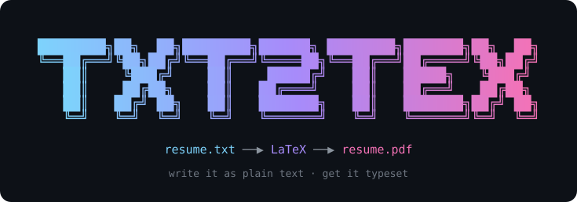
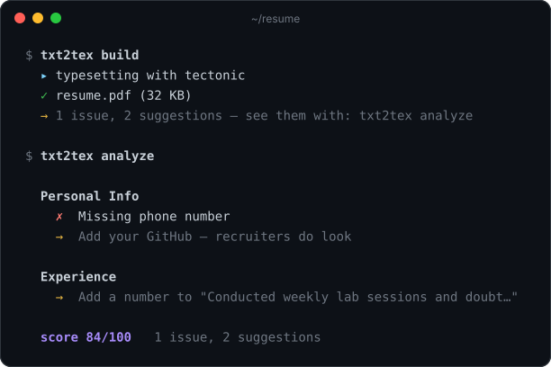

<p align="center">
  
</p>

<p align="center">
  <a href="https://github.com/whynotdeep7/txt2tex/releases/latest"></a>
  <a href="https://github.com/whynotdeep7/txt2tex/actions/workflows/ci.yml"></a>
  
  
  <a href="LICENSE"></a>
</p>

<p align="center">
  <b>Write your resume as plain text. Get a typeset PDF.</b><br>
  <sub>
    <a href="#-install">Install</a> ·
    <a href="#-use">Use</a> ·
    <a href="#-the-file-format">File format</a> ·
    <a href="#-writing-a-resume-worth-reading">Analyzer</a> ·
    <a href="#-how-it-works">How it works</a> ·
    <a href="#-development">Development</a>
  </sub>
</p>

---

No LaTeX, no Word, no drag-and-drop. Edit fields in a terminal UI (or your own
editor), press `b`, get a PDF that looks like it was set by a typesetter —
because it was.

<p align="center">
  
</p>

---

## 📦 Install

**macOS / Linux**

```bash
curl -fsSL https://raw.githubusercontent.com/whynotdeep7/txt2tex/main/install.sh | sh
```

**Windows** (PowerShell)

```powershell
irm https://raw.githubusercontent.com/whynotdeep7/txt2tex/main/install.ps1 | iex
```

The installer downloads the prebuilt binary for your machine from the latest
release and puts it on your PATH. It does not install a toolchain or touch your
shell config.

You also need [tectonic](https://tectonic-typesetting.github.io), which does
the actual typesetting:

```bash
brew install tectonic          # macOS
cargo install tectonic         # Linux
choco install tectonic         # Windows
```

<details>
<summary><b>Other ways to install</b></summary>

<br>

Download a binary yourself from the
[latest release](https://github.com/whynotdeep7/txt2tex/releases/latest):

| Platform | Binary |
|---|---|
| macOS (Apple Silicon) | [`txt2tex-macos-arm64`](https://github.com/whynotdeep7/txt2tex/releases/latest/download/txt2tex-macos-arm64) |
| Linux (x86_64) | [`txt2tex-linux-x86_64`](https://github.com/whynotdeep7/txt2tex/releases/latest/download/txt2tex-linux-x86_64) |
| Windows (x86_64) | [`txt2tex-windows-x86_64.exe`](https://github.com/whynotdeep7/txt2tex/releases/latest/download/txt2tex-windows-x86_64.exe) |

```bash
# e.g. on macOS
curl -fsSL https://github.com/whynotdeep7/txt2tex/releases/latest/download/txt2tex-macos-arm64 -o txt2tex
chmod +x txt2tex && mv txt2tex ~/.local/bin/
```

Or build from source on any platform with Rust 1.88+ (this is the way for
Intel Macs):

```bash
cargo install --git https://github.com/whynotdeep7/txt2tex
```

</details>

---

## ⌨️ Use

```bash
txt2tex
```

That's the whole thing. It opens the editor on `resume.txt`, creating one from
a template if you don't have one yet.

```
┌ Sections ────────────────┐┌ Analyzer ─────────────────────────────────────┐
│   Personal Info          ││→ Add a number to "Conducted weekly lab sess…" │
│   Education              ││                                               │
│ ▸ Experience     3       ││                                               │
│   Projects       3       ││                                               │
│   Skills         4     ✗ ││                                               │
└──────────────────────────┘└───────────────────────────────────────────────┘
┌ Experience ───────────────────────────────────────────────────────────────┐
│   Experience 1 · Google Summer of Code                                    │
│   company    Google Summer of Code                                        │
│   role       Open Source Contributor                                      │
│▸  duration   May 2023 -- Aug 2023                                         │
│   •          Contributed to a Rust networking library with 8k stars       │
│    + bullet                                                               │
└───────────────────────────────────────────────────────────────────────────┘
 saved resume.txt
 ↑↓ move · Tab section · i edit · a add · d delete · s save · b build · q quit
```

The analyzer runs as you type, and the `✗` next to a section tells you where
the problems are. Nothing is written to disk until you press `s` or `b`, so
quitting without saving undoes everything.

### Keys

| Key | |
|---|---|
| `↑` `↓` / `j` `k` | move between fields |
| `Tab` / `⇧Tab` | next / previous section |
| `1`…`5` | jump to a section |
| `i` / `Enter` | edit the selected field |
| `a` | add an entry to this section |
| `d` | delete the selected entry or bullet (asks first) |
| `s` | save |
| `b` | save and build the PDF |
| `o` | open the PDF |
| `?` | help |
| `q` | quit |

While editing, `Enter` or `Esc` finishes and keeps what you typed, and `Ctrl-U`
clears the field.

### Other commands

```bash
txt2tex new                    # create resume.txt, then open the editor
txt2tex edit                   # use $EDITOR instead of the built-in UI
txt2tex build                  # just build the PDF
txt2tex build --no-open        # ...and don't open it afterwards
txt2tex build -o out/cv.pdf    # write the PDF somewhere specific
txt2tex build --tex > cv.tex   # print the LaTeX instead of building
txt2tex analyze                # print the feedback and a score
txt2tex -f other.txt analyze   # work on a different file
```

Progress goes to stderr and results to stdout, so `--tex` pipes cleanly.

---

## 📝 The file format

Line-oriented and forgiving. Unknown keys and sections are ignored rather than
rejected, so a typo costs you one field, not the build.

```ini
# PERSONAL INFORMATION
name: Alex Johnson
email: alex@example.com
phone: +1 555-867-5309
github: github.com/alexjohnson

# EDUCATION
degree: B.Tech Computer Science
university: State Technical University
year: 2020 -- 2024

# EXPERIENCE

experience:
company: Tech Corp
role: Backend Intern
duration: Summer 2022
- Built REST APIs serving 50k requests per day
- Cut p99 latency from 800ms to 120ms

# PROJECTS

project:
title: FastSearch
tech: Rust, Actix-web, Docker
- Indexed 1M documents in under 2 seconds
- Served 5000 queries per second

# SKILLS
Languages: Rust, Python, TypeScript
Developer Tools: Git, Docker, PostgreSQL
```

- Section headers start with `#`. Case doesn't matter, and the space is
  optional — `# SKILLS`, `#skills` and `# Technical Skills` all work.
- Fields are `key: value`. Values can contain colons.
- Bullets start with `- `.
- Comma-separated values become lists.
- Blank lines are ignored.

Projects also accept prose instead of bullets, which gets split into one bullet
per sentence:

```ini
project:
title: FastSearch
description: Indexed 1M documents in under 2 seconds. Served 5000 queries/sec.
tech: Rust, Docker
```

Opening a file like that in the editor converts it to explicit bullets when you
save. The PDF is identical either way.

### Special characters

`& % $ # _ { } ~ ^ \` are escaped for you. Write your name as `John & Jane` and
it typesets correctly. URLs keep their `_` and `~`.

---

## 🎯 Writing a resume worth reading

`txt2tex analyze` scores the file out of 100 and says what to fix:

```
  Personal Info
    ✗  Missing phone number
    →  Add your GitHub — recruiters do look

  Experience
    →  Add a number to "Conducted weekly lab sessions and doubt…"

  score 84/100   1 issue, 2 suggestions
```

It flags missing contact details, projects with no tech stack, entries with no
bullets, and — the one that matters — bullets with no numbers in them.
"Reduced p99 latency 85%" beats "optimized performance", and the analyzer will
keep asking until you write the first kind.

---

## ⚙️ How it works

```
  resume.txt ──parser──▶ Resume ──template──▶ LaTeX ──pdf──▶ resume.pdf
                           │  ▲
                  analyzer │  │ writer
                           ▼  │
                    Vec<Finding>, resume.txt
```

Each stage is a plain function with no shared state, which is why nearly all of
it is testable without a terminal or a LaTeX install.

```
src/
  main.rs       argument parsing and orchestration, nothing else
  model.rs      Resume, Experience, Project, SkillGroup
  parser.rs     text → Resume
  writer.rs     Resume → text (the parser's inverse, so the UI can save)
  template.rs   Resume → LaTeX
  latex.rs      escaping
  analyzer.rs   Resume → Vec<Finding>, as data — the CLI and UI both render it
  report.rs     terminal output for the CLI
  pdf.rs        runs tectonic
  editor.rs     $EDITOR handling
  which.rs      PATH lookup
  open.rs       opens the finished PDF
  tui/
    app.rs      state machine: key in, state out, no I/O
    rows.rs     a section → the lines on screen
    edit.rs     one-line text editor
    field.rs    addresses one string inside a Resume
    ui.rs       drawing
```

The PDF layout is [Jake Gutierrez's resume
template](https://github.com/jakegut/resume), widely used and ATS-friendly.

---

## 🛠️ Development

```bash
cargo test            # 99 tests
cargo clippy          # clean
cargo fmt
cargo run -- analyze
```

The TUI is tested by rendering to an in-memory backend, so the layout and key
handling are covered in CI without a terminal.

### Releasing

Binaries are built by GitHub Actions, not on your machine. To ship a version:

```bash
# 1. bump `version` in Cargo.toml, then
git commit -am "release v0.4.0"
git tag v0.4.0
git push && git push --tags
```

Pushing the tag runs [`release.yml`](.github/workflows/release.yml), which
builds macOS, Linux and Windows binaries and attaches them to a new
[release](https://github.com/whynotdeep7/txt2tex/releases). The installers
download from `releases/latest/download/…`, which always redirects to the
newest release, so nothing else needs updating.

Every push to `main` also runs [`ci.yml`](.github/workflows/ci.yml):
formatting, clippy and the tests on all three platforms.

---

## 📄 License

[MIT](LICENSE) © DeepS
